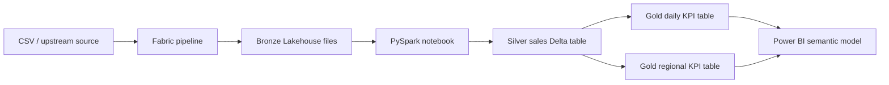

# Fabric KPI Intelligence

An end-to-end portfolio project that turns raw sales orders into validated silver data and gold KPI tables. The code is designed for a Microsoft Fabric notebook, while the included sample data makes the transformations easy to review.

## Architecture

## Repository contents

- `notebooks/01_build_kpis.py`: Fabric-ready PySpark transformation.
- `data/sales_orders.csv`: safe synthetic input data.
- `sql/serving_views.sql`: optional Azure SQL serving views.
- `powerbi/measures.dax`: measures to add to a Power BI model.
- `pipeline/pipeline_parameters.json`: parameters for a Fabric pipeline.

## Run in Microsoft Fabric

1. Create a Fabric workspace and a Lakehouse named `KpiLakehouse`.
2. Upload `data/sales_orders.csv` to `Files/landing/sales_orders.csv`.
3. Create a notebook, attach `KpiLakehouse`, and paste in `notebooks/01_build_kpis.py`.
4. Run the notebook. It creates:
   - `silver_sales`
   - `gold_daily_kpis`
   - `gold_region_kpis`
   - `dq_rejected_sales`
5. Create a Fabric Data Pipeline with a notebook activity and use the parameters from `pipeline/pipeline_parameters.json`.
6. Build a Power BI semantic model over the gold tables and add the supplied DAX measures.
7. Publish the report to Power BI Service.

## Suggested report pages

1. Executive overview: revenue, orders, units, average order value.
2. Regional performance: revenue and margin by region.
3. Product analysis: category and product trends.
4. Data quality: accepted and rejected records.

## Resume-safe claims after you run it

- Built a Fabric-ready medallion pipeline in PySpark with validation, rejected-record handling, Delta tables, and business KPI aggregations.
- Published reusable Power BI measures for revenue, margin, order volume, and period-over-period analysis.

Do not add performance percentages unless you benchmark them and retain the evidence.
